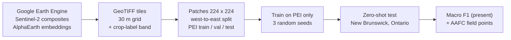

# Cross-Regional Transfer of Crop-Type Classifiers: Do Earth-Observation Foundation Models Help?

**Evidence from Three Canadian Provinces (Prince Edward Island, New Brunswick, Ontario)**

> Status: manuscript in preparation.
> This repository contains the data-export scripts, notebooks and result tables behind the study.

---

## 1. Summary

Labelled crop maps are expensive, and most regions do not have them. A crop classifier is only
useful at scale if a model trained where labels exist still works where they do not.

This study trains crop-type classifiers **only on Prince Edward Island (PEI)** and then tests them,
**with no retraining**, on **New Brunswick (NB)** and **Ontario (ON)**. We compare three families of
models:

| Family | Models |
|---|---|
| Classic machine learning | Random Forest, XGBoost |
| Deep networks trained by us | U-Net (ResNet34), SegFormer |
| Pretrained foundation models | Prithvi-EO-2.0 (NASA/IBM), TerraMind (IBM/ESA), AlphaEarth Foundations (Google DeepMind) |

**Research question:** which kind of model keeps its accuracy when the farming region changes?

**Main findings**

1. **AlphaEarth embeddings transfer best.** On Ontario, every AlphaEarth variant scores 0.12 to 0.15
   Macro F1 higher than every Sentinel-2 model.
2. **The input representation matters more than the classifier.** Even a plain Random Forest on
   AlphaEarth embeddings beats the deep networks trained on Sentinel-2.
3. **Pretrained Sentinel-2 foundation models (Prithvi, TerraMind) did not clearly beat a plain
   U-Net** when about 217 labelled training patches were available. On the field points, the
   24-channel U-Net beats both Prithvi variants on PEI and NB; Prithvi fine-tuned is ahead of it only
   on Ontario.
4. **Pretraining helps only when labels are very scarce** (10% of the labels). At 25% and above the
   advantage disappears.
5. **AlphaEarth is also best on the independent AAFC field-survey points in every region** (PEI, NB and
   Ontario), so the ranking is not an artifact of the label map.

---

## 2. Workflow



---

## 3. Data

All inputs are exported from Google Earth Engine (GEE) onto the **same 30 m grid**, so pixel
`(row, col)` in a Sentinel-2 tile is the same ground square in its AlphaEarth twin tile.

| Data | What it is | Resolution | Source |
|---|---|---|---|
| Sentinel-2 composites | 4 cloud-free composites across the growing season; 6 bands each (Blue, Green, Red, NIR, SWIR1, SWIR2), giving 4 x 6 = 24 features per pixel | 30 m grid | Copernicus Sentinel-2 via Google Earth Engine |
| AlphaEarth embeddings | 64-number annual summary per pixel for 2020 | 30 m grid (native 10 m) | `GOOGLE/SATELLITE_EMBEDDING/V1/ANNUAL` in Google Earth Engine |
| Crop labels | AAFC Annual Crop Inventory (ACI), 2020 | 30 m | Agriculture and Agri-Food Canada |
| Ground truth | AAFC field-survey points (NB: 1,422 points; ON: 111 points) | points | Agriculture and Agri-Food Canada |
| Boundaries | Study-area map | n/a | Natural Earth |

Notes on the files:

- Sentinel-2 tiles have 25 bands: 24 features plus the crop label.
- AlphaEarth tiles have 65 bands: 64 features plus the crop label. Values are stored as small integers
  (`round(embedding x 127)`, with `-128` meaning no data) to keep files small.
- The data tiles are **not stored in this repository** because of their size. Regenerate them with the
  scripts in `gee/` (see Section 7).

Please check the licence of each dataset on its own page before reuse.

### Classes

Five crop classes are kept. All other ACI codes are set to an "ignore" value (255) and are skipped
in both the loss and the scoring.

| Index | Class | ACI code |
|---|---|---|
| 0 | Potatoes | 177 |
| 1 | Pasture and Forages | 122 |
| 2 | Barley | 133 |
| 3 | Corn for Grain | 147 |
| 4 | Wheat | 140 |

---

## 4. Method

### 4.1 Patches and the train / validation / test split

- Tiles are cut into **224 x 224 pixel patches** (the input size Prithvi expects).
- A patch is kept only if at least 5% of it is labelled and at least 50% is valid.
- Training patches overlap with a stride of 112 pixels.
- **Split by geography, not at random.** Patches are sorted west to east. The westernmost patches
  form the training set, the next ~12% the validation set, and the easternmost 30% the test set.
  A buffer of one patch width (about 6.7 km) separates the parts.
- A random split would leak information, because neighbouring fields look alike. The geographic
  split is stricter and more honest.
- This gives **217 training patches**, which is a small training set. This matters for the larger models.

### 4.2 Models

| # | Model | Input | Pretrained? | What is trained |
|---|---|---|---|---|
| 1 | Prithvi-EO-2.0-300M, frozen encoder | 6 bands x 4 dates | Yes (NASA/IBM) | Decoder only |
| 2 | Prithvi-EO-2.0-300M, full fine-tune | 6 bands x 4 dates | Yes | Everything |
| 3 | U-Net control (ResNet34), 4 dates | 24 channels | ImageNet start only | Everything |
| 4 | TerraMind-v1-base, frozen | 6 bands x 1 mid-season date | Yes (IBM/ESA) | Decoder only |
| 5 | U-Net control (ResNet34), 1 date | 6 channels | ImageNet start only | Everything |
| 6 | AlphaEarth + U-Net head | 64 embedding channels | AlphaEarth is pretrained | U-Net head |
| 7 | AlphaEarth + Random Forest | 64 numbers per pixel | AlphaEarth is pretrained | Forest |
| 8 | AlphaEarth + XGBoost | 64 numbers per pixel | AlphaEarth is pretrained | Boosted trees |

The classic Sentinel-2 Random Forest, XGBoost and SegFormer models are in the first notebook
(see Section 6).

**Why the U-Net controls exist.** A U-Net sees the same data as the foundation model but has no
satellite pretraining. If a large foundation model cannot beat it, pretraining did not help for this
task. The 24-channel U-Net is the fair control for Prithvi, the 6-channel U-Net is the fair control for
TerraMind, and the AlphaEarth U-Net head is the control for AlphaEarth with tree models.

### 4.3 Training settings (foundation-model notebook)

| Setting | Value |
|---|---|
| Epochs / batch size | 25 / 4 |
| Optimiser | AdamW (weight decay 1e-4) |
| Learning rates | pretrained encoder 1e-5, new decoder 2e-4, U-Net 3e-4 |
| Schedule | 2 warm-up epochs, then cosine decay |
| Loss | 0.5 x cross-entropy + 0.5 x Dice loss |
| Class weights | square root of inverse frequency, capped at 2.0 |
| Augmentation | random flips |
| Precision | mixed precision (AMP) |
| Random Forest / XGBoost | 300 trees / estimators; up to 30,000 pixels per class (balanced sampling) |
| Seeds | 42, 43, 44 |

**Model selection uses PEI validation only.** The epoch with the best validation Macro F1 is kept.
NB and ON are never used for selection, so the transfer scores are not inflated.

### 4.4 Input normalisation

- Prithvi uses the statistics it was pretrained with.
- U-Net and TerraMind use statistics measured on PEI training patches.
- Missing pixels become 0 after normalisation, which is the mean value, so they carry no signal.

---

## 5. Evaluation

### 5.1 Test areas

| Test area | What it tests |
|---|---|
| **PEI test** (eastern 30% of PEI, buffered) | In-domain accuracy |
| **New Brunswick** (windows NB_A, NB_B) | Transfer; limited, because ACI has very few potato, barley and wheat pixels there, so only pasture and corn can be scored reliably |
| **Ontario** (windows ON_A, ON_B) | The strong transfer test: all five crops present |
| **AAFC field points** (PEI, NB 1,422, ON 111) | Independent check, because ACI is itself a model product |

### 5.2 Metrics

- **Macro F1 (present)** is the headline metric. It is the average F1 over classes with enough real
  examples in the test area (at least 5,000 pixels, or 30 points for field points). Tiny classes would
  otherwise add random noise.
- **Macro F1 (balanced):** scored on an equal-sized sample per class, comparable to the tree models.
- **Per-class recall** is also saved.
- **Transfer drop** = PEI score minus Ontario score. A smaller drop means better transfer.

---

## 6. Repository structure

```
crop-type-transfer-foundation-models/
├── README.md
├── LICENSE
├── gee/
│   ├── gee_export_foundation_model_inputs_v2.js     # Sentinel-2 composites + labels
│   └── gee_export_alphaearth_inputs_v2.js           # AlphaEarth embeddings + labels
├── notebooks/
│   ├── 01_<name>.ipynb          # TODO: classic tier (Random Forest, XGBoost, SegFormer on Sentinel-2)
│   ├── 02_<name>.ipynb          # TODO: describe in one line
│   └── kaggle_foundation_models_v2.ipynb            # Prithvi, TerraMind, U-Net, AlphaEarth models
├── results/
│   ├── results_fm.csv                               # every run
│   ├── results_fm_summary.csv                       # mean and std over seeds
│   └── results_fm_recall.csv                        # per-class recall
└── figures/
```

---

## 7. How to reproduce

### Step 1: Export the data from Google Earth Engine

1. Open the [GEE Code Editor](https://code.earthengine.google.com/) with an account that has access
   to the AlphaEarth dataset.
2. Run `gee/gee_export_foundation_model_inputs_v2.js` to export the Sentinel-2 tiles.
3. Run `gee/gee_export_alphaearth_inputs_v2.js` to export the AlphaEarth tiles.
4. Both scripts write GeoTIFF tiles to Google Drive on the same 30 m grid, with the ACI crop label
   as the last band.
5. Upload the tiles as Kaggle datasets (or link them from Drive).

### Step 2: Run the notebooks on Kaggle

1. Open a notebook on Kaggle, choose a **GPU** accelerator and turn **Internet on**. The pretrained
   weights are downloaded at run time.
2. Run the install cell, then **restart the session** and do not run the install cell again.
   Installing replaces NumPy in the running session and can cause a BLAS error.
3. Set the switches at the top of the notebook:
   ```python
   RUN_PRITHVI_FROZEN = True    # on/off switch for each model
   SEEDS = [42, 43, 44]         # list of seeds to run
   EPOCHS, BATCH = 25, 4
   RUN_SCARCITY = False         # set True for the label-scarcity study
   ```
4. Run all cells. The notebook saves the three result CSV files.

### Environment

Python on Kaggle GPU notebooks, with:

- PyTorch
- TerraTorch (Prithvi and TerraMind loaders)
- segmentation_models_pytorch (U-Net)
- Hugging Face Transformers (SegFormer)
- scikit-learn and XGBoost (tree models)
- rasterio (reading GeoTIFFs), NumPy, pandas

Exact versions: see `requirements.txt` (TODO: add) or the pip log in the notebooks.

---

## 8. Results

Macro F1 (present), mean ± standard deviation over 3 seeds. NB covers pasture and corn only.

| Model | PEI test | New Brunswick | Ontario | Drop PEI to ON |
|---|---|---|---|---|
| AlphaEarth + XGBoost | 0.778 ± 0.002 | 0.906 ± 0.003 | **0.647 ± 0.015** | -0.13 |
| AlphaEarth + U-Net head | **0.789 ± 0.007** | 0.903 ± 0.007 | 0.637 ± 0.022 | -0.15 |
| AlphaEarth + Random Forest | 0.783 ± 0.001 | **0.913 ± 0.000** | 0.617 ± 0.006 | -0.17 |
| U-Net (24 channels) | 0.756 ± 0.013 | 0.851 ± 0.042 | 0.501 ± 0.007 | -0.26 |
| Prithvi-EO-2.0, full fine-tune | 0.690 ± 0.002 | 0.775 ± 0.002 | 0.495 ± 0.001 | -0.20 |
| Prithvi-EO-2.0, frozen | 0.642 ± 0.006 | 0.738 ± 0.003 | 0.462 ± 0.006 | -0.18 |
| U-Net (1 date) | 0.611 ± 0.016 | 0.808 ± 0.007 | 0.398 ± 0.018 | -0.21 |
| TerraMind, frozen (1 date) | 0.532 ± 0.011 | 0.712 ± 0.036 | 0.355 ± 0.019 | -0.18 |
| Sentinel-2 Random Forest / XGBoost / SegFormer | TODO: add from `results/` | | | |

**How to read this table.** A difference smaller than about two standard deviations is not
trustworthy. The standard deviation measures training randomness only, not uncertainty of the test
region.

### Results on AAFC field points

Macro F1 on the AAFC field-survey points, mean over 3 seeds. Because ACI is itself a model product,
field points give an independent check.

| Model | PEI (all points) | PEI (held-out east) | New Brunswick | Ontario |
|---|---|---|---|---|
| AlphaEarth + Random Forest | 0.92 | 0.91 | 0.92 | 0.96 |
| AlphaEarth + XGBoost | 0.92 | 0.87 | 0.89 | 0.95 |
| AlphaEarth + U-Net head | 0.91 | 0.89 | 0.89 | 0.94 |
| U-Net (24 channels) | 0.86 | 0.86 | 0.85 | 0.68 |
| Prithvi-EO-2.0, full fine-tune | 0.77 | 0.68 | 0.76 | 0.76 |
| Prithvi-EO-2.0, frozen | 0.75 | 0.65 | 0.73 | 0.62 |
| U-Net (1 date) | 0.78 | 0.70 | 0.82 | 0.61 |
| TerraMind, frozen (1 date) | 0.69 | 0.61 | 0.72 | 0.50 |
| Sentinel-2 Random Forest / XGBoost / SegFormer | TODO: add from the other two notebooks | | | |

Accuracy and balanced accuracy are saved for every model and region in `results/`, so manuscript
tables can show all three metrics.

**Ranking**

- AlphaEarth is best in every region.
- The 24-channel U-Net beats both Prithvi variants on PEI and NB.
- Prithvi fine-tuned is ahead of the 24-channel U-Net only on Ontario (0.76 vs 0.68).
- TerraMind (frozen, 1 date) is lowest in every column.

**Which classes are counted**

- PEI: potatoes, pasture, barley and wheat on the held-out east set. Corn is left out of that column
  because it has only 16 points.
- New Brunswick: pasture and corn only.
- Ontario: potatoes, pasture, corn and wheat.

**How to read it**

- *PEI (all points)* includes points inside the area the models were trained on, so it is the most
  optimistic PEI number. *PEI (held-out east)* is the cleanest PEI number, but it has only 323 field
  points, so treat it as a small sample.
- Almost every model scores lower on the held-out east than on all PEI points, as expected. The
  24-channel U-Net is unchanged (0.86 on both).
- Ontario has only 111 field points, so differences of a few hundredths should not be over-read.
- On Ontario the ranking between the U-Net and Prithvi depends on the metric: they tie on the
  map-based score (0.501 vs 0.495) but Prithvi is ahead on the field points (0.76 vs 0.68). AlphaEarth is
  clearly best on both.

### Further findings

- **Field-point check.** See the field-point table above. AlphaEarth is best in every region on
  both the map-based and the field-point scores.
- **Label scarcity (single seed, 42).** With 10% of the labels, Prithvi full fine-tune
  (0.601 PEI, 0.437 ON) beat the 24-channel U-Net (0.513, 0.354). At 25%, the U-Net caught up
  (0.689 vs 0.661 on PEI). AlphaEarth models stay near 0.75 to 0.80 on PEI even with 10% of the labels.
- **Ontario wheat.** AlphaEarth models reach wheat recall of 0.67 to 0.77, while Sentinel-2 models
  stay at 0.25 or lower. A possible reason is that Ontario's wheat is mostly winter wheat, which is
  harvested in July, while the Sentinel-2 stack covers May to October. **This is a hypothesis,
  not a tested result.**
- **Barley** is hard for every model (recall 0.18 to 0.44); it resembles other cereals.

---

## 9. Limitations

- One training region and one year (2020).
- A single train/test geography split.
- ACI labels are themselves model-derived, and the Ontario field-point sample is small (111).
- **AlphaEarth is not a like-for-like comparison with the Sentinel-2 models.** It is an annual,
  multi-sensor product pretrained by Google on far more information than four Sentinel-2 composites.
  The result partly says that richer input beats less input.
- TerraMind was used in a restricted configuration (one date, 6 of 12 bands, frozen encoder,
  217 training patches). The result describes that configuration and is not a verdict on the model.
- Nothing can be concluded about NB potato, barley or wheat.
- Pixels close together are not independent, so real uncertainty is larger than the seed standard
  deviation suggests.

---

## 10. Data sources and licences

| Data | Provider | Where to find it |
|---|---|---|
| Sentinel-2 | European Space Agency / Copernicus | Google Earth Engine catalogue |
| AlphaEarth Foundations Satellite Embedding V1 (annual) | Google DeepMind | Google Earth Engine catalogue |
| Annual Crop Inventory (ACI) | Agriculture and Agri-Food Canada | Government of Canada open data |
| Field-survey points | Agriculture and Agri-Food Canada | Government of Canada open data |
| Boundaries | Natural Earth | naturalearthdata.com |

Check each dataset page for its licence and citation requirements.

---

## 11. Authors and contributions

- **[Your name]** (NUST-IGIS): TODO, write 2 to 3 lines on your exact tasks, for example data export
  in Google Earth Engine, notebook development, model training, evaluation, and figures.
- **[Co-authors]:** TODO

Contact: [your email] | [your GitHub link]

---

## 12. Citation

If you use this work, please cite (TODO: update when the manuscript is available):

```
[Authors]. Do Earth-Observation Foundation Models Improve the Cross-Regional Transfer of
Crop-Type Classifiers? Evidence from Three Canadian Provinces. Manuscript in preparation, 2026.
```

Key methods and models used:

- Szwarcman et al. (2024). Prithvi-EO-2.0: A versatile multi-temporal foundation model for Earth observation.
- Jakubik et al. (2025). TerraMind: Large-scale generative multimodality for Earth observation.
- Brown et al. (2025). AlphaEarth Foundations: An embedding field model for global mapping.
- Ronneberger et al. (2015). U-Net: Convolutional networks for biomedical image segmentation.
- Xie et al. (2021). SegFormer: Simple and efficient design for semantic segmentation with transformers.
- Chen and Guestrin (2016). XGBoost: A scalable tree boosting system.
- Breiman (2001). Random forests.

---

## 13. Licence

TODO: choose a licence (for example MIT for code) and add a `LICENSE` file.
